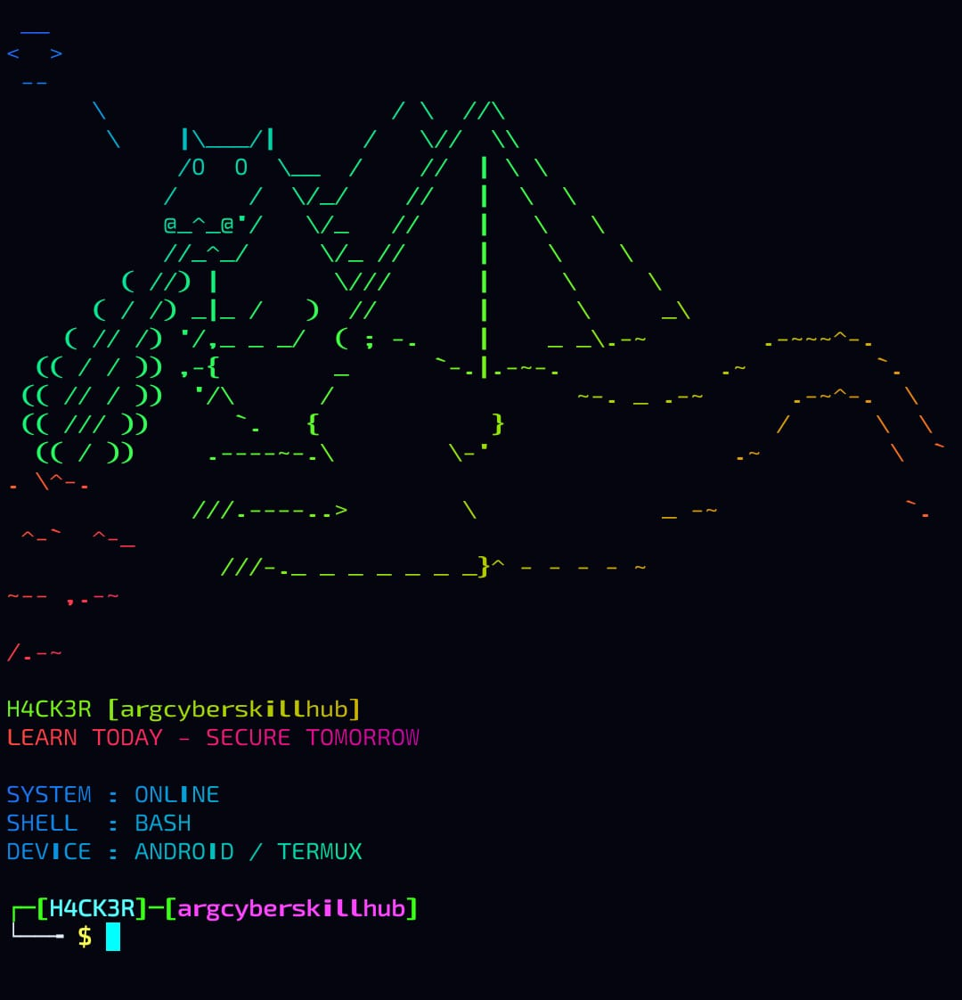

# 🐉 Dragon Banner Maker Pro

A customizable startup banner maker for **Termux**. Personalize your username, tagline, ASCII artwork, banner colours, and shell prompt. The banner loads automatically in new interactive Bash sessions.

> This project customizes your local Termux shell appearance. It does not perform hacking or access other devices.

<h2 align="center">📸 Project Screenshot</h2>

<p align="center">
  
</p>

## ✨ Features

- Create or update your Termux startup banner.
- Choose cowsay artwork: Dragon, Tux, Stegosaurus, Vader, Ghostbusters, or a random installed character.
- Set your own username, banner label, and tagline.
- Choose Rainbow (`lolcat`) or a solid colour.
- Choose Classic, Two-line Arrow, or Minimal prompt styles.
- Toggle the tagline and system-information lines.
- Preview the current banner and list available cowsay characters.
- Uninstall the maker's startup hook without removing unrelated `.bashrc` settings.
- Run the maker again whenever you want to update your banner.

## 📋 Requirements

- Android with [Termux](https://github.com/termux/termux-app).
- Bash and an internet connection for first-time package installation.
- `cowsay` for character artwork.
- `lolcat` for the rainbow effect (optional; solid-colour output is available without it).

## 🚀 Installation

### 1. Update packages

```bash
pkg update && pkg upgrade -y
```

### 2. Put the script in Termux home

Download `Dragon-Banner-Maker.sh` or clone repo and copy it from Android's Download folder:

```bash
git clone https://github.com/argcyberskillhub/Termux-Banner.git
```

```bash
termux-setup-storage
cp /storage/emulated/0/Download/Dragon-Banner-Maker.sh ~/
```

Adjust the source path if you saved the script elsewhere.

### 3. Make it executable and run it

```bash
chmod +x ~/Dragon-Banner-Maker.sh
bash ~/Dragon-Banner-Maker.sh
```

Follow the menu prompts. The script attempts to install missing dependencies.

## 🧭 Menu options

| Option | Action |
|---|---|
| 1 | Create or update banner |
| 2 | Preview current banner |
| 3 | List available cowsay artwork |
| 4 | Uninstall banner |
| 5 | Exit |

Enter your username, label, tagline, artwork, colour, prompt style, and display preferences.

## 🔁 View the banner

Open a new Termux session after installation. The maker adds a marked startup block to `~/.bashrc` and loads its generated startup file for interactive Bash sessions.

To test it immediately:

```bash
source ~/.config/dragon-banner-maker/startup.sh
```

If another startup script also sets `PS1`, the prompt assigned by the last script sourced will be active.

## 🛠️ Configuration files

The maker stores its files in:

```text
~/.config/dragon-banner-maker/
├── settings
└── startup.sh
```

- `settings` stores your selected options.
- `startup.sh` displays the banner and sets the selected prompt.

The startup block in `~/.bashrc` is marked with:

```bash
# >>> DRAGON BANNER MAKER >>>
...
# <<< DRAGON BANNER MAKER <<<
```

## 🧹 Uninstall

Run the maker and choose **4) Uninstall banner**. This removes its own marked startup block and configuration directory, while preserving unrelated `.bashrc` content.

Before manual shell-configuration edits, make a backup:

```bash
cp ~/.bashrc ~/.bashrc.backup
```

Do not delete your entire `~/.bashrc` just to remove this banner; it may contain other aliases, prompts, and settings.

## ⚠️ Troubleshooting

### `cowsay: command not found`

```bash
pkg install cowsay -y
```

### Rainbow colours are missing

```bash
pkg install ruby -y
gem install lolcat
```

If `lolcat` cannot be installed, select a solid colour in the maker.

### Banner does not appear

Check that the startup hook and generated file exist:

```bash
grep -n "DRAGON BANNER MAKER" ~/.bashrc
ls -l ~/.config/dragon-banner-maker/startup.sh
```

Make sure you are using an interactive Bash session and that `~/.bashrc` is being read.

### Another banner or prompt appears too

Multiple startup scripts can print banners or set `PS1`. Keep only the hooks you want. The last script that assigns `PS1` controls the final prompt.

## 🔐 Safety notes

- Review scripts before running them.
- The maker is intended to edit only its own marked section in `~/.bashrc`.
- Keep a backup of important shell configuration before manual changes.

## 📄 License

No license is specified yet. Add a license file before redistributing the project if you want to define reuse and modification permissions.

---

**Dragon Banner Maker Pro — Customize your Termux startup, your way.** 🐉
